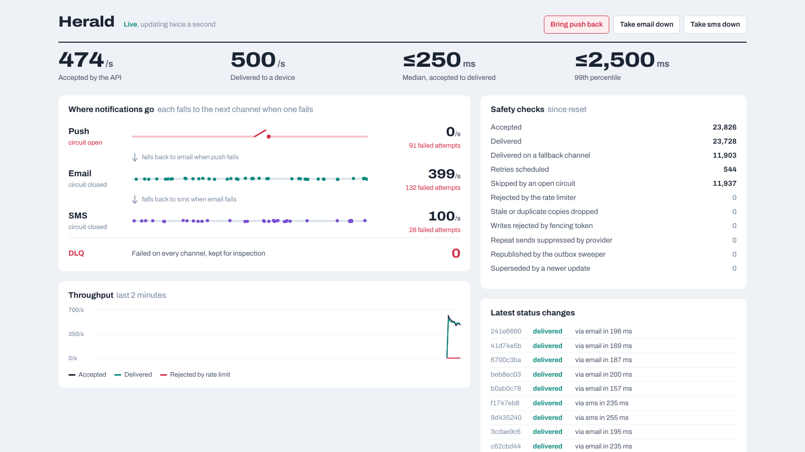
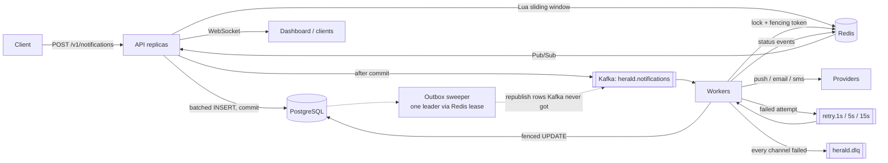

# Herald

Herald is a notification platform written in Go. Applications send it a notification over HTTP; Herald delivers it by push, email or SMS, falls back to the next channel when one fails, and keeps every notification accounted for when providers, workers or Kafka go down.

It's built to show how an event-driven backend stays correct under concurrency and failure: Kafka retry topics and a dead-letter queue, a Redis Lua sliding-window rate limiter, Redis locks with fencing tokens, a transactional outbox, circuit breakers, and a live WebSocket dashboard. Every claim below is backed by a test or a benchmark in this repo.



**Measured on one 2-vCPU VM that also ran Kafka, PostgreSQL, Redis, the mock providers and the k6 load generator:**

- **1,600 requests/s sustained** for 60 s with zero errors, API p99 141 ms, median delivery 0.26 s ([all runs](bench/README.md))
- **Coalescing round trips cut API p99 from 280 ms to 81 ms** and median delivery from 7.6 s to 0.19 s at 1,200 req/s
- **No accepted notification lost** when Kafka was stopped for 15 s, a worker was `kill -9`'d, or the push provider went down mid-load ([chaos results](#failure-handling))

## How it works



1. **Accept.** The API checks the tenant's rate limit (one Lua script in Redis), then hands the request to a batcher. Concurrent requests share one multi-row `INSERT` and one commit. The client gets `202 Accepted` only after its row is durable.
2. **Publish.** Right after the commit, the row is produced to Kafka, keyed by recipient so one recipient's notifications stay in order. The `notifications` table doubles as the outbox: rows with `published_at IS NULL` are re-published by a sweeper that runs on exactly one API replica, elected with a Redis lease.
3. **Deliver.** Workers in a Kafka consumer group take a Redis lock for the notification, which comes with a fencing token. They claim the row in PostgreSQL and call the provider for the first channel.
4. **Retry, fall back, dead-letter.** A retryable failure goes to a retry topic (1 s, then 5 s, then 15 s). When a channel's retries run out, or its circuit breaker is open, the worker falls through to the next channel. A notification that fails on every channel goes to `herald.dlq` with its full error history.
5. **Watch.** Workers publish status changes to Redis Pub/Sub; every API replica streams them to WebSocket clients, including the dashboard at `/`.

## Failure handling

| What goes wrong | What Herald does | Proven by |
|---|---|---|
| The same message is delivered twice (outbox republish, Kafka redelivery) | Each message carries a step number. The claim only succeeds if the row is still at that step, so copies are dropped before reaching a provider. | `TestDuplicateMessageIsDropped`, `TestStaleStepIsDropped`; 600-notification run with 10% duplicated messages: 0 repeat sends (`TestEndToEndUnderFaults`) |
| A worker stalls past its lock lease (GC pause, slow network) while another takes over | The newer holder has a higher fencing token. PostgreSQL rejects the stale worker's writes, and the provider rejects its send. | `TestPausedWorkerIsFenced`: one send, one rejected stale send |
| An older update arrives after a newer one ("shipped" after "out for delivery") | Notifications that share a `collapse_key` are serialized by a lock, and an older one is marked `superseded` instead of being shown. | `TestOlderUpdateIsSupersededWhenItArrivesLate`; ordering check across 600 notifications |
| A provider goes down | 5 consecutive failures open that channel's circuit breaker; traffic skips straight to the next channel. A single probe closes it again when the provider recovers. | Chaos run below, `TestBreakerOpensProbesAndCloses` |
| Kafka goes down | The API keeps answering `202`, because accepted rows are safe in PostgreSQL. When Kafka returns, the outbox sweeper republishes them. | Chaos run below |
| A worker crashes | Offsets are committed only after a batch is fully handled, so Kafka redelivers to the surviving worker; the idempotency checks above make that safe. | Chaos run below |
| A message can't be decoded | It goes straight to the DLQ with the error and its source offset, instead of blocking the partition. | `poison()` in [worker.go](internal/worker/worker.go) |
| A tenant floods the API | The sliding window rejects the excess with `429` and an accurate `Retry-After`, identically on every replica. | `TestSlidingLogExactUnderConcurrency`: 400 concurrent requests from 4 "replicas", exactly 100 allowed |

**Chaos runs** (600 req/s for 60 s, two workers, fault injected at 15 s and repaired at 30 s, [script](bench/chaos.sh)):

| Fault (at 15 s, repaired at 30 s) | Accepted | Lost | API errors | API p99 | Delivery p99 | What happened |
|---|---|---|---|---|---|---|
| Kafka broker stopped | 36,000 | **0** | 0 | 102 ms | 31.2 s | API kept answering `202`; sweeper republished 39 rows; 1,636 duplicate copies dropped; 0 repeat sends |
| A worker `kill -9`'d, replaced 15 s later | 36,001 | **0** | 0 | 41 ms | 9.5 s | Survivor took its partitions after the 10 s session timeout; 1,292 redelivered copies dropped; 4 in-flight sends repeated and absorbed by the provider's idempotency key |
| Push provider down | 36,001 | **0** | 0 | 27 ms | 1.2 s | Circuit opened; 7,303 notifications delivered by email or SMS instead; 0 repeat sends |

## Benchmarks

Everything ran on one 2-vCPU, 7.8 GB VM, so the API, worker, Kafka, PostgreSQL, Redis, the mock providers and k6 itself all shared two cores. k6 alone used about 40% of one core. A real deployment would put these on separate machines; treat these numbers as a floor, not a ceiling.

k6 uses an open model (`constant-arrival-rate`): it starts requests on schedule whether or not earlier ones have finished, so a slow server shows up as latency and unsent requests, not a politely lower rate. "Delivery" is the time from the API accepting a notification to the provider confirming it, measured in PostgreSQL. The mock providers add 7–90 ms of latency per call and fail 2% of calls at random, so some deliveries include a retry.

| Rate | Achieved | Not sent | Errors | API p50 | API p99 | Delivery p50 | Delivery p99 |
|---|---|---|---|---|---|---|---|
| 1,400/s | 1,400/s | 0.0% | 0% | 17 ms | 100 ms | 0.22 s | 1.25 s |
| **1,600/s** | **1,598/s** | **0.1%** | **0%** | **23 ms** | **141 ms** | **0.26 s** | **1.29 s** |
| 1,800/s | 1,764/s | 1.9% | 0% | 50 ms | 243 ms | 1.08 s | 2.82 s |
| 2,000/s | 1,889/s | 5.2% | 0% | 72 ms | 343 ms | 1.32 s | 3.75 s |

Up to 1,600 req/s, delivery keeps pace with intake, and p99 sits near 1.3 s: that is the 1 s retry delay for the ~2% of calls the mock providers fail on purpose. From 1,800 req/s the machine is saturated and delivery starts to queue. Single runs on a shared VM vary: an earlier 1,800 req/s run, before the deadlock fix described below, reached 1,791/s with a 168 ms p99.

### What actually made it fast

My first load tests fell seconds behind on delivery at only 1,000 req/s. A CPU profile showed 43% of the worker's time in system calls: each delivered notification cost about seven network round trips (lock, claim, begin, update, commit, unlock, provider).

The fix was [coalescing](internal/coalesce/coalesce.go): when many goroutines need the same kind of query at once, they share one SQL statement or one Redis pipeline. A batch is whatever queued up while the previous one was in flight, so a lone request isn't delayed. I also had API-side insert batching from the start. Turning each off in turn, at a fixed 1,200 req/s:

| Configuration | Not sent | API p99 | Delivery p50 | Delivery p99 |
|---|---|---|---|---|
| Both on | 0.0% | 81 ms | 0.19 s | 1.22 s |
| No coalescing | 2.0% | 280 ms | 7.58 s | 19.49 s |
| No insert batching | 0.0% | 115 ms | 0.21 s | 1.24 s |
| Neither | 8.5% | 672 ms | 10.17 s | 25.16 s |

Insert batching, the optimization I expected to matter, did little at 1,200 req/s: batches averaged 2.2 rows. It matters near saturation, where batches grow (6.2 rows at 1,800 req/s): there, turning it off raised API p99 from 243 ms to 575 ms and left 10.3% of requests unsent instead of 1.9%.

### The bug the chaos tests found

Batching created a deadlock. The API's batched "mark published" UPDATE and the workers' batched "claim" UPDATE touched the same rows in different orders, so PostgreSQL aborted one of them. The worker retried, and because the provider had already accepted that notification, the retry sent it again. Only the provider's idempotency key stopped 26 duplicate sends in one chaos run.

Every multi-row update now locks its rows in id order first. [`TestBatchedUpdatesDoNotDeadlock`](internal/store/store_test.go) failed reliably before the fix and passes after; the same chaos run then showed 0 repeat sends.

Full method, raw JSON for every run, and commands to reproduce: [bench/README.md](bench/README.md).

## Design decisions

**Retry topics instead of in-place retries.** Sleeping in a consumer blocks its whole partition. Instead, a failed message moves to a topic with a fixed delay (1 s, 5 s or 15 s). Every message in such a topic waits the same amount, so each partition is already in due-time order and the consumer only waits on the head.

**Fencing tokens, not just locks.** A Redis lease can expire while its holder is paused, and the holder won't know. Each acquisition also increments a global counter. PostgreSQL rows and the provider reject any write carrying a token older than one they've seen, which is what makes the lock safe rather than merely likely to work.

**Sliding log by default, sliding counter as an option.** The sliding log stores one sorted-set entry per request and is exact: no window of any alignment admits more than the limit. The counter keeps two integers and assumes the previous window's requests were spread evenly. Both use Redis `TIME` inside the script, so API replicas with skewed clocks still agree. Set `HERALD_RATELIMIT_ALGO=counter` for high limits where memory matters.

**PostgreSQL as the outbox.** Writing to the database and producing to Kafka can't be one transaction. Herald commits to PostgreSQL first and treats unpublished rows as the outbox, so a Kafka outage delays delivery but never loses an accepted notification.

**At-least-once plus idempotency, not "exactly once".** The provider can't take part in a Kafka transaction, so exactly-once delivery isn't available end to end. Herald guarantees at-least-once processing and makes each step idempotent: stale steps are dropped, writes are fenced, and provider calls carry an idempotency key.

## Run it

**With Docker** (2 API replicas, 2 workers):

```sh
docker compose up --build
open "http://localhost:8080/?key=admin-key"
```

**From source** (needs Go 1.26, PostgreSQL 16, Redis 7 and Kafka 4 running locally):

```sh
scripts/dev-up.sh 2 2     # 2 API replicas from :8080, 2 workers
go test -race ./...       # integration tests use the same local services
```

Send a notification:

```sh
curl -X POST localhost:8080/v1/notifications \
  -H 'Authorization: Bearer demo-key' \
  -H 'Idempotency-Key: order-42-shipped' \
  -d '{"recipient_id": "user-7", "channels": ["push", "email", "sms"],
       "collapse_key": "order-42", "payload": {"title": "Your order shipped"}}'
# 202 {"id": "01a1...", "status": "queued", ...}
```

## API

| Method | Path | Notes |
|---|---|---|
| `POST` | `/v1/notifications` | `recipient_id` required; `channels` defaults to `push, email, sms` (fallback order); optional `collapse_key`; `payload` is a JSON object up to 16 KiB. Send `Idempotency-Key` to make retries safe: a repeat returns `200` with the original ID. Rate-limited per tenant: `429` with `Retry-After`. |
| `GET` | `/v1/notifications/{id}` | Current status, attempts, channel used, last error. |
| `DELETE` | `/v1/notifications/{id}` | Cancels if not yet delivering; `409` otherwise. |
| `GET` | `/v1/ws?api_key=…` | WebSocket stream of status changes for the tenant. Add `notification_id=` to follow one notification. The admin key also receives aggregate stats twice a second. Slow clients lose messages (and are told how many) rather than slowing everyone else. |
| `POST` | `/v1/admin/chaos` | Admin only. Takes a mock provider channel down or changes its failure rate. |
| `GET` | `/metrics`, `/healthz`, `/readyz` | Prometheus metrics and probes. |

## Configuration

| Variable | Default | |
|---|---|---|
| `HERALD_TENANTS` | `demo-key:demo:50/1s,load-key:load:100000/1s` | `api_key:tenant:limit/window`, comma-separated |
| `HERALD_ADMIN_KEY` | `admin-key` | Dashboard, stats and fault injection. Change it. |
| `HERALD_RATELIMIT_ALGO` | `log` | `log` (exact) or `counter` (constant memory) |
| `HERALD_RETRY_DELAYS` | `1s,5s,15s` | One Kafka topic per delay; retries per channel = number of delays |
| `HERALD_BATCH_MAX` | `500` | Max rows per `INSERT`; `1` disables insert batching |
| `HERALD_COALESCE_MAX` | `256` | Max calls per coalesced statement or pipeline; `1` disables coalescing |
| `HERALD_WORKER_CONCURRENCY` | `256` | Concurrent deliveries per worker |
| `HERALD_LOCK_TTL` | `10s` | Delivery lock lease |
| `HERALD_POSTGRES_URL`, `HERALD_REDIS_ADDR`, `HERALD_KAFKA_BROKERS`, `HERALD_PROVIDER_URL` | local defaults | |

## Layout

```
cmd/herald/          one binary: migrate | api | worker | provider | all | report
internal/api/        HTTP handlers, insert batcher, outbox publisher and sweeper, WebSocket hub
internal/worker/     Kafka consumers, delivery, retries, fallback, DLQ
internal/ratelimit/  sliding log and sliding counter, as Redis Lua scripts
internal/lock/       Redis lease lock with fencing tokens
internal/coalesce/   merges concurrent calls into batched round trips
internal/breaker/    per-channel circuit breaker
internal/store/      PostgreSQL schema and fenced state transitions
internal/provider/   mock push/email/SMS providers with fault injection
web/                 live dashboard
bench/               k6 scenarios, benchmark and chaos scripts, raw results
```

## Limitations

- **The providers are mocks.** They simulate latency, random failures, outages and invalid recipients, and they honour idempotency keys, but no real push, email or SMS is sent. Real providers differ in what idempotency they support.
- **Benchmarks ran on a single machine with a single Kafka broker** (replication factor 1). The design runs multi-replica (see `docker-compose.yml`), but I haven't measured a multi-node cluster.
- **Authentication is static API keys** from configuration. There are no per-recipient preferences, quiet hours or templates.
- **Notifications are kept forever.** There is no retention job yet.
